 # Relación de Ejercicios de Binario y de Puertas Lógicas
		
> @autor: Esteban Amador

## Relación 3

### Ejercicio 1 
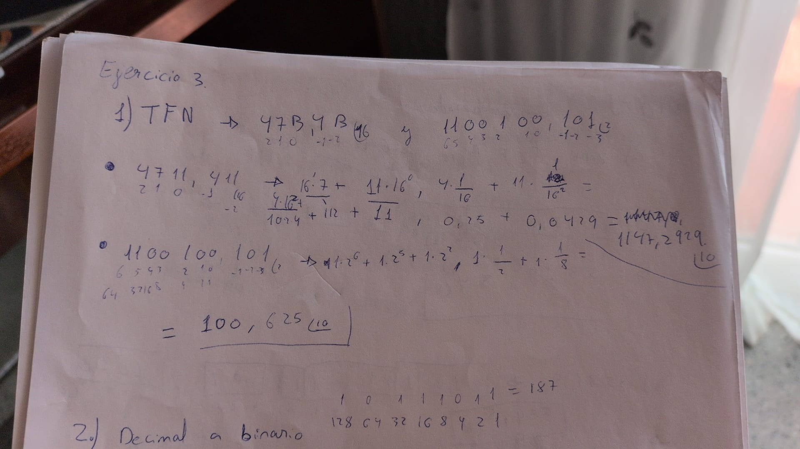
- Apartado A solución
Resultado  1147,2929
- Apartado B solución
Resultado 100,625

### Ejercicio 2
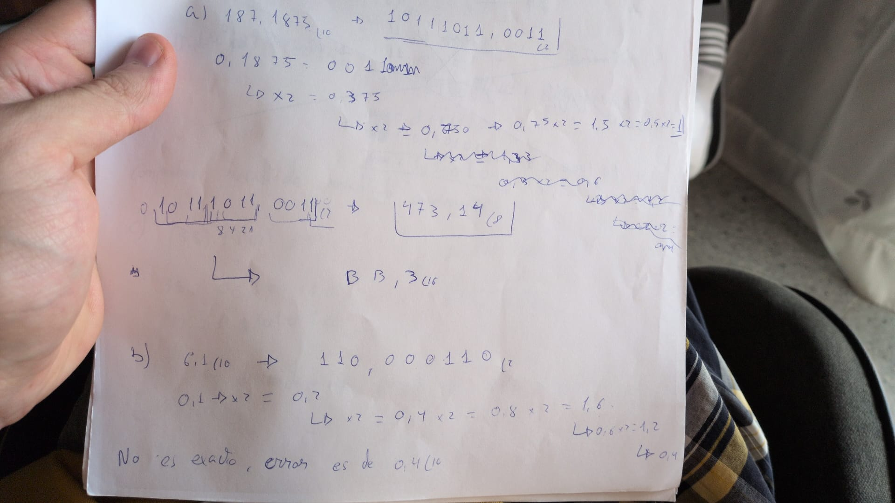
-Apartado A 
Resultado: 10111011,0011 (2
473,14(8
BB,3(16

-Apartado B
Resultado: 110,000110 (2
No es exacto, el error es de 0,4

### Ejercicio 3
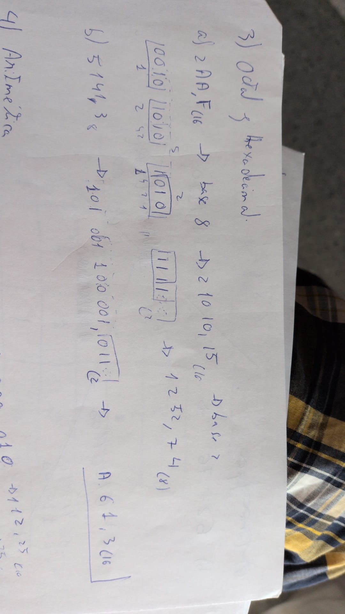
-Apartado A
Resultado: 1252,74(8
-Apartado B
Resultado A61,3(16

### Ejercicio 4
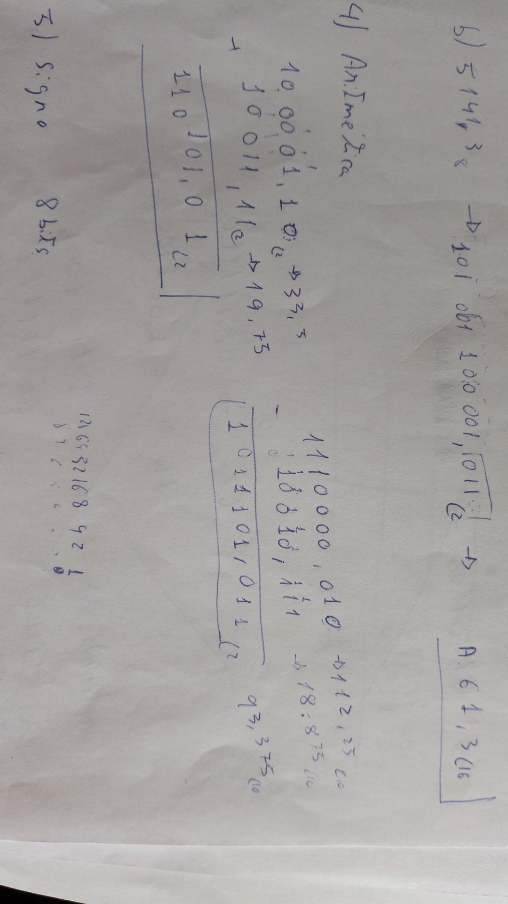
-Apartado A
Resultado: 110101,01(2
Decimal 19,75(10 
-Apartado B 
Resultado 1011101,011 (2
Decimal 93,375 (10

### Ejercicio 5
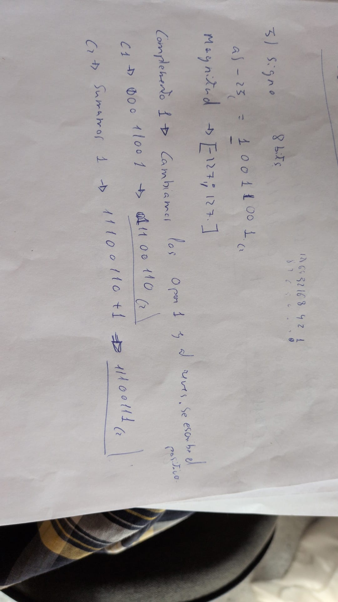
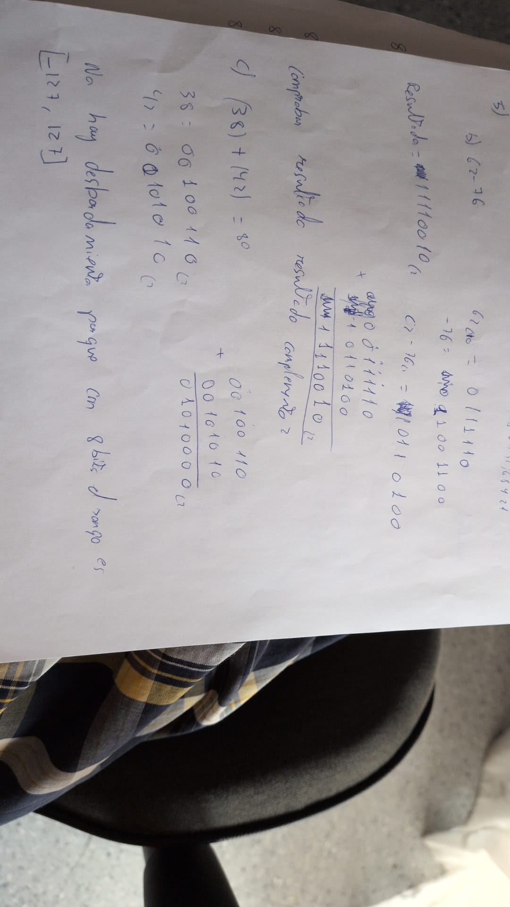
-Apartado A
-Magnitud 127'127
Complemento 1 = 10110011 (2
Complemento 2 = 11100111 (2
-Apartado B 
Resultado: 11110010 complemento 2
Resultado 10001110 = -14
-Apartado C 
Resultado: 01010000 (2
No hay desbordamiento ya que se encuentra entre los valores -127'127
-Apartado D
Resultado: 100001110 
Como el 1 esta fuera del rango se descarta, el resultado real es 00001110
Que es 14 en decimal.
Se ha realizado el c2 del numero de arriba.

### Ejercicio 6
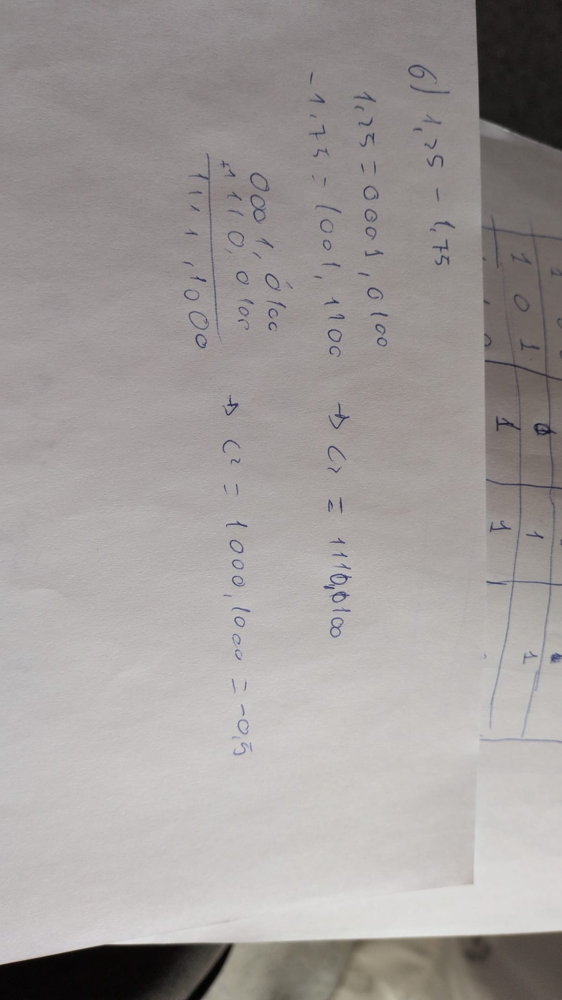
-Apartado A
1,25 = 0001,0100(2
-1,75= 0001,1100(2
c2 -1,75 =1110,0100
Suma = 1111,1000
c2 suma = 1000,1000
Decimal -0,5

### Ejercicio 7
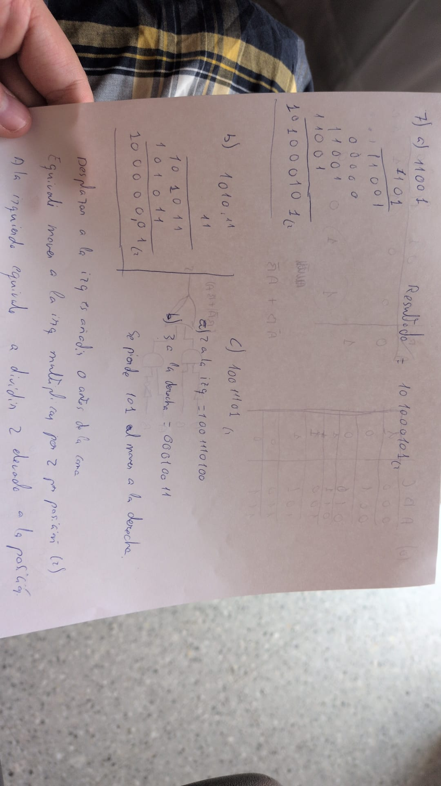
-Apartado A
Resultado: 101000101 (2
-Apartado B
Resultado: 100000,01 (2
-Apartado C
Resultado desplazar 2 a la izq : 1001110100
Resultado de desplazar 3 a la der : 00010011

Desplazar a la izquierda consiste en añadir 0 a la izquierda de la coma.
Desplazar a la derecha consiste en añadir 0 al final del numero, se pierden los numero al "empujar" contra la coma. En este caso se pierde 101.

### Ejercicio 8
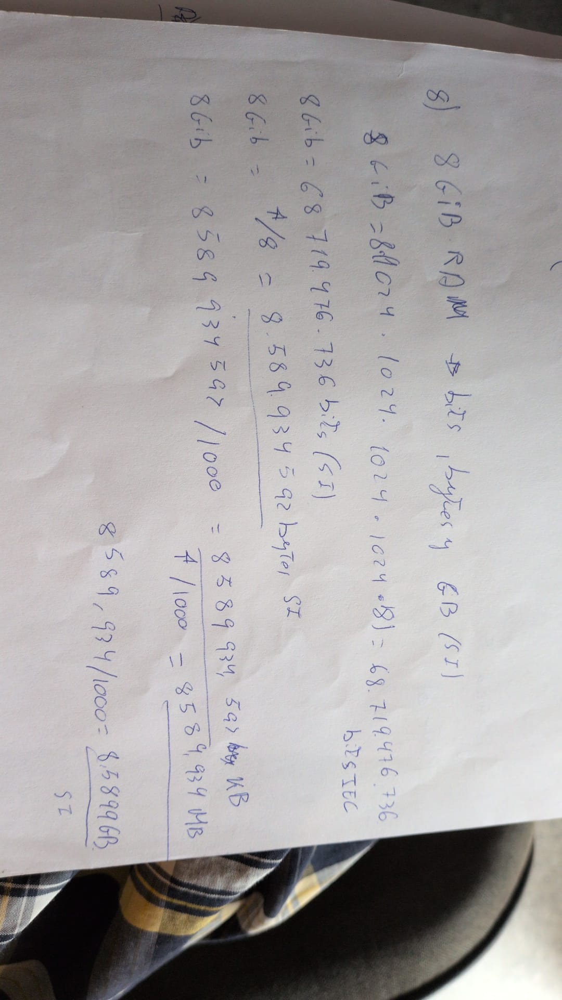
Resultado A
Bits = 68719476736
byte 8589934592
GB= 8,5899 SI
Si cada byte tiene 2 elevado a 8 direciones y se necesita 8 bits para numerar cada direccion.

### Ejercicio 9
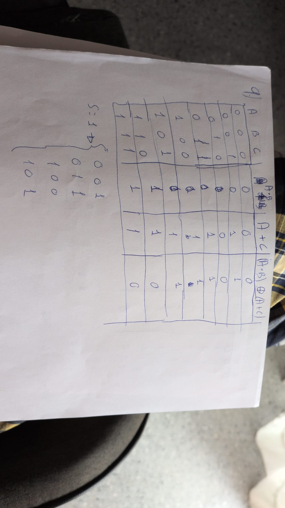
|ABC|AB|A+C|AB XOR A+C|
|000|0|0|0|
|001|0|1|1|
|010|0|1|1|
|011|0|0|1|
|100|0|1|1|
|101|0|1|1|
|110|1|1|0|
|111|1|1|0|
S = 001 o 010 o 011 o 100 o 101

### Ejercicio 10
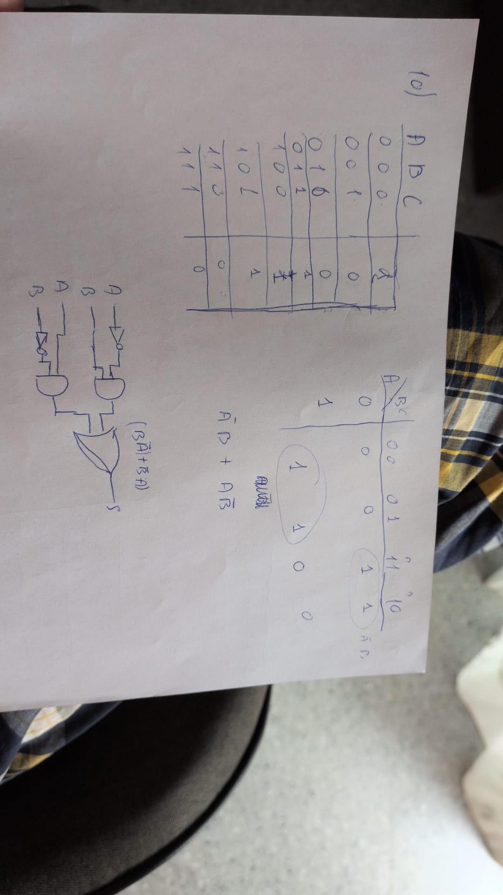
|ABC|(!A)B OR (A!B)|
|000|0|
|001|0|
|011|0|
|100|1|
|101|1|
|110|5|
|111|0|

|A/BC|00|01|11|10|
|0|0|0|1|1|
|1|1|1|0|0|

A(negada)B + AB(negada)
